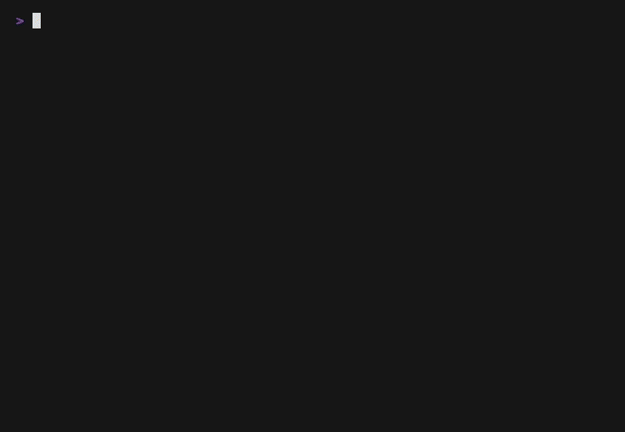

# termling

[](https://github.com/punitmishra/termling/actions/workflows/ci.yml)
[](https://crates.io/crates/termling)
[](LICENSE)
[](https://github.com/punitmishra/termling/releases)

> An animated ASCII creature that lives *beside* your shell and reacts to how
> your commands go — shifting moods, earning XP, and hiding a little arcade for
> when the build is slow. **Your shell stays 100% your own.**



A little **animated, multi-color** ASCII creature that lives in a pane *beside
your shell* and reflects **its mood** based on how your commands go. It
breathes, blinks, waves, spins, and throws sparks in real time — over a
**mood-matched backdrop** — and a whole **cast of characters** takes turns on
stage as you work.

Crucially, **your shell stays entirely your own.** termling never wraps or
replaces it — no toy shell, nothing between you and your shell. Your terminal,
your config, your completions, your prompt, your aliases: all untouched. A tiny
hook (zsh, bash, or fish) just whispers "a command started / finished with exit
N" to the companion pane, and the creature reacts.

Successful commands earn **XP** (streaks multiply it), you can switch **themes**
to suit your terminal, and there's a small **arcade** of mini-games for when a
build is running.

It also has a **buddy brain**: a tiny, fully-local learner that watches which
tools you run and *talks back* in a speech bubble — greeting a tool it's never
seen, cheering a clean build, nudging you after a failure, and noticing when a
command ran slow *for you*. It learns your workflow entirely on-device —
**still zero network calls, still no new dependencies.**

Press **`d`** for a **dashboard**: a sidebar of info panes (git status, system
vitals, buddy stats) — plus optional, off-by-default online panes (weather,
stocks, news, dev-news, and a Claude "ai tip") that only ever run in an
`--features online` build with `TERMLING_ONLINE=1`. The stock binary stays
local-only.

```
┌─ your zsh (100% yours) ────┐┌─termling · focused─┐
│ ~/proj ❯ git checkout <TAB>││       \ o /        │
│ checkout   cherry-pick     ││      ( ^   ^ )     │
│ ~/proj ❯ cargo test        ││      /|     |\     │
│ test result: ok. 60 passed ││  lv 4 ███░░░ 340xp │
│ ~/proj ❯ █                 ││  streak 3 · best 7 │
│                            ││  ✓ git             │
│                            ││  ✓ cargo           │
│                            ││ g play · aurora · q│
└────────────────────────────┘└────────────────────┘
   your real shell, with            the companion
   completions & prompt             (this program)
```

The left pane is **your own zsh** — termling isn't drawing it. The right
pane is this program.

## Install

Grab the binary one of these ways, then wire up the shell hook (**Quick start**,
below):

> **v0.1.0 is out.** The **one-line installer** and **prebuilt tarballs** below
> work now (macOS Apple Silicon + x86_64 Linux). **Homebrew** and `cargo install
> termling` are marked _“pending publish”_ — the release pipeline is wired for
> both but they stay dark until the maintainer adds the crates.io / Homebrew-tap
> tokens (see **Releasing**). Any platform with a Rust toolchain can always
> install from the repo today:
>
> ```sh
> cargo install --git https://github.com/punitmishra/termling
> ```
>
> That puts `termling` on your `PATH` (in `~/.cargo/bin`) — and it's the path for
> **Intel macOS**, which doesn't have a prebuilt tarball yet. To update a `--git`
> install later, re-run that same command — cargo won't refresh it on its own.

**One-line installer** (macOS & Linux, no sudo — installs to `~/.local/bin`):

```sh
curl -fsSL https://raw.githubusercontent.com/punitmishra/termling/main/scripts/install.sh | sh
```

It detects your OS/arch, downloads the matching release tarball, verifies its
SHA-256, and drops `termling` in `${TERMLING_INSTALL_DIR:-$HOME/.local/bin}`.
This installer script is the *only* part of termling that touches the network;
the binary itself never does.

**Homebrew** — _pending publish_ (needs the `HOMEBREW_TAP_TOKEN` secret; macOS & Linux):

```sh
brew install punitmishra/termling/termling
```

**Cargo** — _pending publish_ (needs the `CARGO_REGISTRY_TOKEN` secret; until then use `cargo install --git …` above):

```sh
cargo install termling
```

**Prebuilt binaries** — download the tarball for your platform from the
[latest release](https://github.com/punitmishra/termling/releases/latest), then
drop `termling` anywhere on your `PATH`:

```sh
tar xzf termling-*-<your-target>.tar.gz
install -m 0755 termling /usr/local/bin/     # or ~/.local/bin
```

**From source:**

```sh
git clone https://github.com/punitmishra/termling
cd termling
cargo install --path .                        # onto PATH (~/.cargo/bin), no sudo
# …or just build it and run in place:
cargo build --release                         # binary at target/release/termling
```

> **Try it without installing.** `termling init` bakes the *absolute path* of
> whichever binary produced it into the hook, so you can point a shell at a
> local build without touching `PATH` or any rc file:
>
> ```sh
> eval "$(./target/release/termling init zsh)"    # or: init bash | init fish
> ```

## Quick start

**Install the hook** for your shell (additive — it only registers the shell's
command-lifecycle callbacks and changes nothing else):

```sh
eval "$(termling init zsh)"        # ~/.zshrc
eval "$(termling init bash)"       # ~/.bashrc
termling init fish | source        # ~/.config/fish/config.fish
```

Not sure which? Bare `termling init` auto-detects from `$SHELL`.

That's it. **The companion spawns itself** beside your shell the next time you
open one — a tmux split if you're in tmux, or an iTerm2 / kitty / WezTerm split,
once per **scope** (see below) so several panes share one creature instead of
piling up. Just start working.

Every command makes the creature react — `focused` while it runs, `toiling` if
it drags on, then `happy`/`excited` on success or `confused` on failure — and a
small feed shows your recent commands with a `✓`/`✗`. Kick the tires — run a few
commands and watch the pane:

```sh
ls && echo works     # ✓ exit 0 → happy, and your success streak climbs
false                # ✗ exit 1 → confused
sleep 4              # a long one → toiling, then a finish flourish + a bell
```

Companion didn't appear? Run **`termling doctor`** — a quick, network-free check
that reports your scope, whether a companion is live, whether your terminal can
auto-split, and whether the binary is on your `PATH`, each with a concrete fix.

If you'd rather place it yourself (or your terminal can't auto-split), set
`TERMLING_AUTOSPAWN=0` and open it however you like:

```sh
termling tmux                              # splits a 34-col pane (or prints the recipe)
zellij --layout contrib/termling.kdl       # zellij
termling                                   # a plain second terminal window
```

The companion is **ambient** by default (it takes no input — your shell has the
keyboard). Focus its pane and press `g` to open the arcade, `t` to cycle themes,
`q` (or `Ctrl-C`) to quit.

To flip through the doodle frames without a socket or a pane:

```sh
cargo run -- --preview
```

## Staying up to date

```sh
termling update            # upgrade in place
termling update --check    # show installed version; check for newer where it can
termling version           # print the installed version
```

`update` **delegates to whatever installed termling** — it runs `brew upgrade
termling` for a Homebrew install, `cargo install termling --force` for a Cargo
install, or prints the one-line installer for a manual/tarball install. **The
binary makes no network calls of its own** and never checks for updates in the
background; it only shells out to `brew`/`cargo` (which do their own fetching)
at the moment you run the command. `update --check` follows the same routing:
for Homebrew it runs `brew outdated termling` (which reports if a newer one
exists); for Cargo or a manual install — where the network-free binary can't
know — it simply points you at crates.io or the Releases page.

## How the link works

```
  your zsh  ──(preexec/precmd hook)──▶  termling emit  ──datagram──▶  socket
                                                                             │
                              termling  ◀── non-blocking recv ──────────┘
                              (the companion pane)
```

The hook fires a **fire-and-forget datagram** at
`${XDG_RUNTIME_DIR:-<tmpdir>}/termling-<scope>.sock` on every command. If the
companion isn't running, the send fails instantly and is ignored — so **your
prompt never stalls**, whether or not the pane is open. The wire format is a
tiny `\x1f`-delimited `key=value` line: no JSON, no serde, trivial to emit from
zsh and parse in Rust.

Because nothing is ever piped *through* the companion, there is no way for it to
slow down, mangle, or lose your shell's output, completions, or history.

### Scopes & multiple shells

A **scope** is one companion's territory. All shells in the same scope share one
socket (`termling-<scope>.sock`) and one companion, which tracks each shell
as a **roster** — so opening five tmux panes gives you *one* creature that shows
all five, not five creatures. The scope is resolved identically by the hook and
the companion:

1. `TERMLING_SCOPE` — an explicit override.
2. inside **tmux** → the tmux *session* (one companion per session).
3. inside **iTerm2** → the iTerm *window*.
4. otherwise → `default`.

kitty and WezTerm have no per-window case yet, so shells there fall through to
`default` — as does any terminal that isn't tmux or iTerm2 (Terminal.app, most
Linux terminals). Everything on `default` shares **one** companion (the roster
still lists each shell): two kitty windows — or a kitty window and a WezTerm
window, or a plain Terminal.app shell — get one shared creature, not one each.
Per-window scoping is a documented follow-up; set `TERMLING_SCOPE` yourself if
you want a separate companion per window today.

Auto-spawn uses a dependency-free single-instance guard: the companion's socket
`bind` *is* the lock (creating the socket file is atomic), so if two shells start
at once only one companion survives — the other detects the live socket and steps
aside. The ambient pane lists the live shells with a busy/idle marker, each
shell's directory, and its last command's result.

### Long commands & project awareness

- A command that runs a while shifts the creature to **toiling**; when it
  finishes, a little flourish fires and the terminal bell rings. Set
  `TERMLING_NOTIFY=1` for a macOS notification too — handy for a long build
  in another pane.
- The pane shows your current directory, and with `TERMLING_PROJECT_THEME=1`
  each project gets a stable auto-picked theme (off by default so it never fights
  the manual `t` key).
- Level-ups and streak milestones pop a brief confetti flourish.

### Environment knobs

| Variable | Effect |
|----------|--------|
| `TERMLING_PRIVACY` | `name` (default) / `full` / `none` — how much command text leaves the shell |
| `TERMLING_SCOPE` | override the companion's scope (see above) |
| `TERMLING_AUTOSPAWN` | `0` disables spawning the companion at shell startup |
| `TERMLING_NOTIFY` | `1` sends a macOS notification when a long command finishes |
| `TERMLING_PROJECT_THEME` | `1` auto-themes per project directory |
| `TERMLING_ONLINE` | `1` enables the networked dashboard panes (only in an `--features online` build; off by default) |
| `TERMLING_WEATHER` | `"lat,lon"` for the weather pane (online) |
| `TERMLING_STOCKS` | comma-separated tickers for the stocks pane, e.g. `AAPL,MSFT` (online) |
| `TERMLING_PANES` | pick & order dashboard panes, e.g. `git,weather,ai`; unknown/unavailable names are skipped (default: all) |
| `ANTHROPIC_API_KEY` | API key for the Claude "ai tip" pane (online); the pane is inert without it |

### Persistence

Progress is saved to `${XDG_STATE_HOME:-~/.local/state}/termling/state` — a
one-line `"<xp> <best_streak>"` (no serde) — and restored next launch. The
**buddy brain** keeps its learned model next to it in
`${XDG_STATE_HOME:-~/.local/state}/termling/buddy` — a few KB of plain-text,
space-delimited habit and bigram records, bounded so it can't grow unbounded.
Both are local files; delete them to reset. Neither leaves your machine.

## Security

termling is built to be **boring and inspectable** on the security front:

- **The default binary makes no network calls, ever.** The shell↔companion link
  is a local Unix *datagram* socket at
  `${XDG_RUNTIME_DIR:-<tmpdir>}/termling-<scope>.sock`. Nothing leaves your
  machine — no telemetry, no analytics, no background update checks, no
  phone-home. `termling update` only *delegates* to `brew`/`cargo` (which fetch)
  at the moment you run it; the network-touching installer is a separate,
  user-invoked shell script (`scripts/install.sh`), never the binary. The one
  exception is opt-in and explicit — see the online-mode bullet below.
- **Online mode is opt-in and doubly gated.** The networked dashboard panes are
  compiled only in an `--features online` build **and** run only when you set
  `TERMLING_ONLINE=1` — both off by default, so a stock build has no network code
  at all. With both on, termling contacts exactly these hosts, each only for its
  pane: `api.open-meteo.com` (weather), `query1.finance.yahoo.com` (stocks),
  `hacker-news.firebaseio.com` (news), `lobste.rs` (dev-news), and
  `api.anthropic.com` (ai tip). The only thing sent is the request itself — your
  configured coordinates/tickers, and for the ai tip a short fixed prompt plus
  your `ANTHROPIC_API_KEY` in the request header (never logged, never stored).
  **No shell data, command text, directories, or telemetry are ever sent.**
- **It never runs your commands.** The companion is *ambient*: it reads exit
  codes and timings and draws a creature. Your shell input is never piped
  through it, evaluated by it, or otherwise seen by it — only the small event
  line the hook chooses to send (see **Privacy**).
- **The hook is additive and fire-and-forget.** `eval "$(termling init zsh)"`
  (or the bash/fish equivalent) only registers the shell's command-lifecycle
  callbacks; it changes nothing else about your shell, and a failed send is
  silently dropped so your prompt never stalls.
- **Auto-spawn runs local UI commands.** To open its own pane it may invoke
  `tmux`, `osascript`/AppleScript (iTerm2, which prompts once for Automation
  permission), `kitten @` (kitty), or `wezterm cli` (WezTerm). Set
  `TERMLING_AUTOSPAWN=0` to disable this entirely and place the pane yourself.
- **Tiny, auditable dependency surface** — a default build uses only `ratatui`
  and `crossterm`; the socket protocol, RNG, games, and themes are all
  hand-rolled. The optional `online` feature adds `ureq` (rustls, no OpenSSL) +
  `serde` + `serde_json` for the networked panes, and nothing else.
- **Local & single-user by design.** The socket lives in your runtime dir with
  its default permissions; termling assumes a trusted local session and is not
  hardened against hostile local users sharing your `$XDG_RUNTIME_DIR`.

Found a security issue? Please open a GitHub issue and flag it as
security-sensitive.

## Privacy

Commands can carry secrets (`export TOKEN=…`), so **by default only the
command's first word leaves your shell**. Tune it with `TERMLING_PRIVACY`:

| Value  | Sends |
|--------|-------|
| `name` | just the program name, e.g. `git` — the **default** |
| `full` | the whole command line |
| `none` | no command text at all — only exit codes and timing |

Whatever the setting, that data only ever travels the local socket to the
companion pane, where it picks a mood, fills the recent-command feed, and feeds
the **buddy brain**. The buddy learns only from this same filtered tool name —
so `none` keeps it tool-blind (generic quips only) while `name`/`full` let it
recognise and learn tools. What it learns is persisted *locally* to the bounded
buddy file (see **Persistence**) and, like everything else here, is never sent
anywhere off your machine.

## Limitations

Honest about what it is — a fun, small, **local** toy:

- **zsh, bash, and fish.** zsh and fish use native command-lifecycle hooks with
  sub-second timing; bash has no native `preexec`, so it's emulated with a
  `DEBUG` trap + `PROMPT_COMMAND` and its command duration is **second-resolution**
  (enough for the long-command flair). bash allows only one `DEBUG` trap, so if
  you also use bash-preexec or starship's bash hook, **load termling last**; and
  on a compound line `$PIPESTATUS` is reset between commands (a limitation shared
  by every `DEBUG`-trap hook). Other shells (PowerShell, nushell, …) aren't wired
  up yet — contributions welcome (see **Contributing**).
- **Auto-spawn is tmux / iTerm2 / kitty / WezTerm.** kitty needs remote control
  enabled (`allow_remote_control yes`). Everywhere else (Terminal.app, most Linux
  terminals) set `TERMLING_AUTOSPAWN=0` and open the pane yourself with
  `termling tmux`, a zellij layout, or a plain second window. kitty and WezTerm
  (and any non-tmux/non-iTerm2 terminal) fall on the shared `default` scope —
  one companion between them, not one each (see **Scopes**).
- **Needs a modern terminal** — Unicode glyphs and 24-bit truecolor, plus a pane
  at least ~22 columns wide; in a 256-color or ASCII-only terminal the art
  degrades.
- **No Windows** — it relies on Unix domain sockets and a POSIX shell.
- **Single machine, single user** — no remote/SSH-forwarded companion and no
  multi-host awareness; the socket is local only.

## XP & levels

Every command your shell runs that exits `0` earns XP, and a run of successes
multiplies it (capped ×5), so a clean streak is worth chasing. XP rolls up into
levels, shown with a `█████░░░` bar alongside your current and best streak.
Playing a mini-game banks its score as XP too.

## Themes

A **theme** sets the *chrome* tone — borders, HUD text, the XP bar, and the
mini-games' items — without touching the characters (their colors are their
identity). Press `t` in the companion pane to cycle; the current theme's name is
shown on the footer line.

Bundled: `aurora` (default), `neon`, `sunset`, `matrix`, `mono`, `ocean`,
`ember`, `sakura`, `coffee`, `vaporwave`, `forest`. A theme is just six colors
and a name in `theme.rs` — add one to the `const` array and it joins the rotation.

## The arcade (mini-games)

Press `g` (or `Enter`) to open the picker (`↑/↓` to choose, `Enter` to play,
`Esc` back) — handy while a long build churns away in the other pane. In the
picker, **`d` cycles difficulty** (easy / normal / hard — tuning things like
spawn rates and starting lives) and **`s` cycles speed** (calm / normal / fast);
both show on the footer and apply to the game you start. Every game stars your
current character, is tinted by the active theme, speeds up with level, and banks
its score as XP when you leave. Shared controls: movement on `←/→/↑/↓` (or
`wasd`, `hjkl`), `Space` to act, `r` to retry after a game over, `Esc`/`q` to
step out.

| Game         | Goal |
|--------------|------|
| **doodle drop** | Catch **★** (+10) and **◆** gems (+30), dodge **●** bombs. Catches build a combo; a miss resets it; bombs cost a life (3 total). |
| **gap dive**    | Slide your glider to thread the single gap in each falling wall — and scoop the **◆** gem inside it. One mistake ends the dive; the gap narrows and walls arrive faster as you climb. |
| **coil**        | A snake with a temper. Eat `+` food and timed `*` gems to grow; every few bites the arena sprouts a `#` rock. Hit a wall, a rock, or your own tail and it's over. |
| **lane whack**  | Five holes, one mallet. Whack `O` moles and `*` gems with `Space`, but leave `X` bombs alone. A missed mole or a whacked bomb costs a life; fast hits chain a combo. |
| **doodle dash** | An endless runner. Cacti (`#`) scroll in along the ground — tap `Space`/`↑` to hop them. Clear one for a bonus; mistime a jump and the run ends. It scrolls faster the further you get. |
| **star blast**  | A fixed shooter. Slide your ship along the bottom and `Space` to fire straight up at descending invaders (`W`, gold `@`). Pop them for points; let one reach your row and you lose a life (3 total). |
| **muncher**     | A pellet chase. Steer through the maze gobbling `·` pellets; grab a power dot (`O`) and the ghost (`M`) turns edible for a bonus. Clear the board and it refills, faster each lap. Get caught and you lose a life. |
| **brick bounce**| A compact breakout. Slide your paddle to keep the ball in play and clear the brick wall (gold bricks pay extra). Clear it and a fresh wall drops in, faster each time. Drop the ball and you lose a life. |

The picker scrolls, so the list keeps working however many games you add — just
implement the `MiniGame` trait in `src/games/` and list a `GameKind` variant, and
the picker and HUD pick it up automatically.

## The buddy brain

The creature doesn't just emote — it has a little **buddy brain** that learns
*your* workflow and talks back, all **on-device with zero network**:

```
          ╭───────────────────╮
          │ `cargo` ✓ ship it │
          ╰─────────┬─────────╯
                 \ o /
                ( ^   ^ )
                /|     |\
```

Behind the speech bubble are two tiny, hand-rolled structures — no serde, no
model weights, no new crates:

- **Per-tool habits** — how often you run each tool (`git`, `cargo`, `docker`,
  …), how often it succeeds, and how long it usually takes. That's what lets the
  buddy say *"`cargo` took 12.0s — slow for you"*, or greet a tool the first time
  it sees it.
- **A Markov bigram table** — which tool tends to follow which — so after a clean
  build it can anticipate: *"`cargo` ✓ — `git` next?"*.

Each finished command folds into both, and the buddy answers with one short,
toned line: a cheer on success, a gentle nudge on failure (*"`cargo` hit exit 1
— you've got this"*), or a learned observation that fades after a few seconds.

It only ever sees the same privacy-filtered tool name the mood engine does (see
**Privacy**): with `TERMLING_PRIVACY=none` the buddy still cheers and
commiserates — it just won't name or learn individual tools. The model is a
bounded few-KB file (see **Persistence**), so it never grows without limit.

## The dashboard

Press **`d`** in the companion to open the **dashboard**: a sidebar of info
*panes* beside your creature. `↑/↓` pick a pane, **`s` cycles the layout**
(focused → grid → columns → rows — a 2×2 grid, a vertical split, or a horizontal
split, windowed on the selection), `r` refreshes, `esc` returns to the creature.
Choose and order which panes appear with `TERMLING_PANES` (e.g.
`TERMLING_PANES=git,weather,ai`).

It's laid out like a terminal split — the buddy stays in view up top, the panes
sit under it:

```
┌ blob · curious ──────────────────────────────────────────┐
│                       (·◕    ◕·)                          │
│                      '(   ··   ) `                        │
│                       ╰─◡──◡─╯                            │
│             lv 56  ███████░  5592xp · streak 0            │
└───────────────────────────────────────────────────────────┘
┌ panes ───────┐┌ ▸ weather ───────┐┌ hacker news ─────────┐
│▸ weather ·   ││18.6 °C           ││1. Ultramarine 1 Flash│
│  news ·      ││clear sky         ││2. Tesla Roadster     │
│  devnews ·   ││wind 5.9 km/h     ││3. Llama.cpp on a PS5 │
│s columns     ││37.77,-122.42     ││4. Claude reveals ECD…│
│r refresh     ││                  ││5. You could have inv…│
│esc back      │└──────────────────┘└──────────────────────┘
└──────────────┘
```

**Local panes — always available, still zero-network:**
- **git** — branch, staged/dirty counts, ahead/behind, recent commits (read by
  running `git`, a subprocess — never the network).
- **system** — load average, uptime, and memory (from `/proc` on Linux,
  `sysctl`/`vm_stat` on macOS).
- **buddy** — a window onto the [buddy brain](#the-buddy-brain): your most-used
  tools, their success rates, and its next-command prediction.

**Online panes — opt-in, off by default.** Weather (Open-Meteo), stocks (Yahoo
Finance), news (Hacker News), dev-news (Lobsters), and an **ai tip** pane (Claude). These
are the *only* parts of termling that touch the network, and they take **two
gates, both off by default**:

1. Build with the feature: `cargo build --features online` (or
   `cargo install --features online …`). A stock build compiles none of this and
   pulls no network dependencies.
2. Opt in at runtime: `TERMLING_ONLINE=1`. Without it, the online panes stay
   inert and make no requests.

Configure them with `TERMLING_WEATHER="lat,lon"`, `TERMLING_STOCKS="AAPL,MSFT"`,
and `ANTHROPIC_API_KEY` for the ai tip pane (inert without a key). Fetches run on
a background thread and are cached with minutes between refreshes, so the UI
never blocks and the services aren't hammered. Exactly which hosts are contacted,
and what's sent, is spelled out under **Security** and **Privacy**.

## The mood engine

Every frame, `mood::Mood::from_signals` maps a few shell signals to one mood
(first matching rule wins):

| Mood          | When                                         |
|---------------|----------------------------------------------|
| `focused`     | a command is running                         |
| `toiling`     | a command has been running a long time       |
| `curious`     | fresh start, waiting for input               |
| `sleepy`      | idle a long time                             |
| `bored`       | idle a little while                          |
| `caffeinated` | commands firing in rapid succession          |
| `confused`    | last command exited non-zero                 |
| `proud`       | a success right after a failure (recovered!) |
| `excited`     | 3+ successes in a row                        |
| `happy`       | last command exited `0`                      |

## Characters × moods (the creative bit)

The two ideas are kept **orthogonal**, so they multiply instead of add:

- A **character** (`doodle::Character`) is a *silhouette + palette*: the head
  top, the body walls, the base line, and four RGB colors (body, accent, eyes,
  mouth). The cast — `blob`, `cat`, `robot`, `ghost`, `fox`, `comet`, `astra`,
  `mixtape`, `tubeboy`, `jelly`, `draco` — rotates over time and with each
  command (`App::character_seed`).
- A **mood** is an *expression*: the eyes, mouth, and the particles drifting
  around the creature, all animated by the clock (`app.frame`).
- A **scene** is the *backdrop*: sparse, gently-twinkling glyphs filling the sky
  band, the ground, and the side margins behind the creature. Each mood picks a
  fitting one — a starry **night sky**, a breezy **sunny meadow**, a crackling
  **electric buzz**, or cool **deep focus** rails.

`doodle::render(mood, character, frame)` composes them onto a fixed 20×6 canvas
as individually-colored segments — the character painted over its backdrop — so
any mood renders on any character in that character's colors. Add a **character**
(a palette + a few glyphs), a **mood** (one expression), or a **scene** and every
combination lights up for free.

## Layout

- `main.rs`  — subcommand dispatch + terminal setup + steady-cadence event loop
- `app.rs`   — state, mood signals, XP/streaks, the recent-command feed, the multi-shell roster, flair, persistence
- `event.rs` — the shell↔companion wire format, scopes, the datagram socket, liveness probe, and receiver
- `emit.rs`  — the `emit` subcommand the hook fires per command (+ privacy knob)
- `init.rs`  — the `init [zsh|bash|fish]` subcommand that prints the hook (+ `$SHELL` auto-detect)
- `tmux.rs`  — spawning the companion (`tmux`/`ensure`): tmux / iTerm2 / kitty / WezTerm split, single-instance guard
- `update.rs`— the `update`/`version` subcommands: delegate to brew/cargo, no network
- `doctor.rs`— the `doctor` subcommand: a network-free environment checklist
- `mood.rs`  — signals → mood
- `buddy.rs` — the buddy brain: per-tool habits + a Markov bigram learner → toned quips, persisted locally
- `panes/`   — the dashboard: a `Pane` trait + `PaneKind` registry; local panes (git/system/buddy) always, online panes (weather/stocks/news/dev-news/ai) under `--features online`
- `net.rs`   — the single network boundary: a background fetch worker + channel, drained non-blocking; real HTTP only under `--features online`
- `doodle.rs`— characters + mood expressions + scenery → colored ASCII scene
- `games/`   — the arcade: a `MiniGame` trait plus one module per game (difficulty/speed options)
- `rng.rs`   — a tiny dependency-free xorshift PRNG
- `theme.rs` — the switchable chrome/game palettes
- `ui.rs`    — the ratatui layout: ambient creature, arcade, game, and the dashboard split

Two dependencies by default (`ratatui` + `crossterm`); the socket protocol,
games, RNG, and themes are all hand-rolled to keep it lightweight. The optional
`online` feature adds `ureq` + `serde` + `serde_json` for the networked panes.

## Roadmap

Per-window scoping for kitty & WezTerm (a companion per window, rather than the
one they currently share on the `default` scope);
sub-second bash duration where a modern bash is available; more shells
(PowerShell, nushell); per-command mood nuance; and a `zsh/net/socket`
zero-spawn emit path.

## Contributing

Contributions are very welcome — the codebase is deliberately small and
hackable. Some good first PRs, roughly by area:

- **A new mini-game** — implement the `MiniGame` trait in `src/games/` and add a
  `GameKind` variant; the picker and HUD wire it in automatically.
- **A new character** — a silhouette + four RGB colors in `doodle.rs` (see the
  existing cast); it works across every mood for free.
- **A new theme** — six colors and a name in `theme.rs`.
- **A new mood or scene** — a rule in `mood.rs` plus an expression/backdrop in
  `doodle.rs`.
- **Another shell** — a hook alongside the zsh/bash/fish ones in `init.rs`
  (PowerShell and nushell are unclaimed).

To get set up:

```sh
git clone https://github.com/punitmishra/termling
cd termling
cargo run -- --preview     # eyeball the art without a socket or a pane
cargo test                 # the suite is fast and dependency-light
cargo clippy --all-targets # keep it warning-clean
```

Only two runtime dependencies (`ratatui` + `crossterm`) — please keep it that
way where you reasonably can; the sockets, RNG, games, and themes are all
hand-rolled on purpose. Run `cargo fmt`, `cargo clippy`, and `cargo test`
before opening a PR, and open an issue first for anything large so we can agree
on the shape.

## Releasing

termling has no published release yet, which is why `brew install …`, `cargo
install termling`, the `curl` one-liner, and the prebuilt tarballs don't work
yet (install from the repo in the meantime — see **Install**). Cutting a release
is just pushing a tag:

```sh
cargo test && cargo clippy --all-targets -- -D warnings   # green first
git tag v0.1.0 && git push origin v0.1.0
```

That fires `.github/workflows/release.yml`, which:

1. **Builds** release tarballs for `aarch64`/`x86_64` macOS and `x86_64` Linux,
   each with a `.sha256`.
2. **Cuts the GitHub Release** with those assets — this alone makes the `curl`
   one-liner and the prebuilt-tarball instructions work.
3. **Publishes to crates.io** — only if the `CARGO_REGISTRY_TOKEN` repo secret is
   set (else skipped), which lights up `cargo install termling`.
4. **Bumps the Homebrew formula** in the `punitmishra/homebrew-termling` tap —
   only if the `HOMEBREW_TAP_TOKEN` secret is set (else skipped), which lights up
   `brew install punitmishra/termling/termling`.

So a tag with neither secret still gives working `curl`/tarball installs; add
`CARGO_REGISTRY_TOKEN` for crates.io and `HOMEBREW_TAP_TOKEN` for Homebrew. Keep
`Cargo.toml`'s `version` in step with the tag.

## License

Released under the [MIT License](LICENSE) — free to use, modify, and
distribute. Contributions are accepted under the same license.
